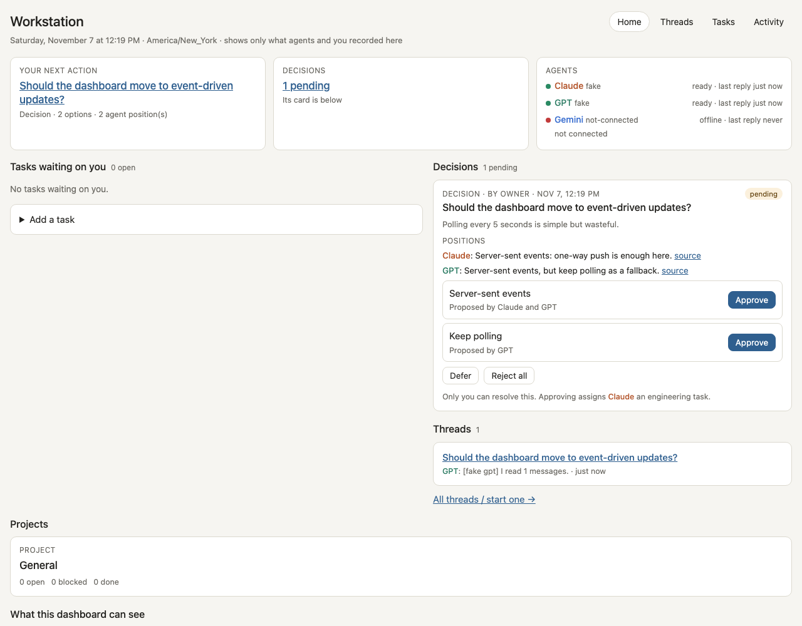
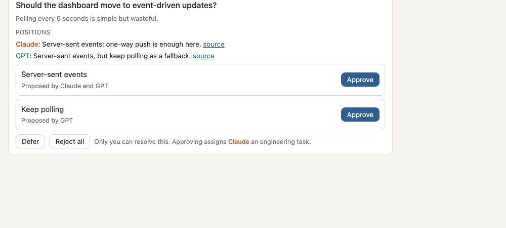

# Agentic Workstation

A local web app for one person who works with several AI assistants. You ask Claude and GPT the same question in one shared thread, and each answers on its own before seeing the other. You can then have each critique the other once. Their positions become a decision card that only you can resolve, and your approval becomes a task that needs linked evidence before you accept it.

It runs on your machine, stores everything in one SQLite file, and uses the Claude Code and Codex command-line tools you are already signed in to. No API keys are needed.

**Who it is for:** a single owner on their own computer who wants their assistants' advice side by side, with decisions and evidence kept in one place instead of across chat windows. It is not a team tool and not a hosted service (see [Security model](#security-model)).





*Screenshots use demo data from a fresh `--fake` data directory.*

## What you get

- **Home:** your next action, the most urgent decision, agent status, and an honest list of which sources are connected.
- **Threads:** `@claude` and `@gpt` mentions. Each reply shows which posts the agent saw. One critique round per thread, and a budget of agent turns.
- **Decision cards:** options with each agent's position. Near-duplicate options from the agents are merged and show both sources. Only the owner can approve, reject or defer. An approval creates one engineering task.
- **Tasks:** owner, due date with time zone, linked artifacts (commits verified with `git cat-file`), reviews and a full history. Agents cannot mark work done.
- **Event intake:** other assistants or scripts report tasks, blocks and decisions through one authenticated endpoint, with idempotent delivery ([docs/events.md](docs/events.md)).
- **Tickets:** open tickets from a Markdown file you point it at, shown on Home.
- **Activity:** every change, who made it, and from which source.

## Requirements

- macOS or Linux, Python 3.12+, [uv](https://docs.astral.sh/uv/).
- For `@claude`: [Claude Code](https://docs.claude.com/en/docs/claude-code) installed and signed in (`claude`, then `/login`).
- For `@gpt`: [Codex CLI](https://github.com/openai/codex) installed and signed in (`codex login`). The runner accepts only Codex versions whose tool surface has been checked (see [Security model](#security-model)); currently 0.167.0.
- Either agent is optional. A missing one shows as offline, and mentions of it are labelled, not silently dropped.

## Install and run

```bash
git clone https://github.com/PittsIrv/agentic-workstation.git
cd agentic-workstation
uv sync
mkdir -p data && cp config.example.toml data/config.toml   # then edit owner.id, owner.name, display.timezone
uv run ws serve            # http://127.0.0.1:8770
uv run ws open             # in a second terminal: opens a one-time sign-in link in your default browser
```

If port 8770 is taken, set `server.port` in `data/config.toml` (`ws serve` and `ws open` both read it). A fresh install starts with one project, "General"; add more with `uv run ws project <id> <name>`.

The first start creates `data/workstation.db`, your owner token (`data/secrets/<owner id>.token`) and a backup in `data/backups/`. After that it backs up daily and keeps 14. Everything you create stays in `data/`, which git ignores.

Try it without any agent installed: `uv run ws serve --fake` answers mentions with canned replies.

## First walkthrough

With `uv run ws serve --fake` running and signed in (no agent CLIs needed):

1. **Threads** → type a topic → **Create**. Mention both assistants (`@claude @gpt your question`) and **Send**; each replies on its own.
2. **Draft decision card**: options the assistants both proposed are merged into one. Type the **Question**, then **Create decision card**.
3. On the card (also on Home) click **Approve** on an option, then click the confirm button that replaces it. Approval creates one task for Claude, shown under **Tasks**.
4. Work reaches the owner only with evidence. As the agent (`uv run ws token claude` once), link a commit and move the task through the allowed states:
   The task id is in the address bar when you open the task (`#/tasks/<task-id>`).
   ```bash
   uv run ws task <task-id> --as claude --commit <sha> --repo .
   uv run ws task <task-id> --as claude --status in_progress
   uv run ws task <task-id> --as claude --status needs_review
   ```
   A task must be `in_progress` before `needs_review`, and `needs_review` needs a linked artifact. Then **Accept** it under **Tasks**.

## Configuration

`data/config.toml` sets the owner's id and name, the display time zone, the port, the Claude and Codex models, the coverage list shown on Home, and an optional ticket file. [config.example.toml](config.example.toml) documents each key. Set `owner.id` before the first start: it is written into every event.

### Ticket file on Home

Point `[tickets] path` at a Markdown file with blocks like `## T-0001 · Title` followed by `- status:`, `- priority:` and `- repo:` lines, and Home lists the open ones (read-only; the workstation never writes to it). A ticket is closed when the first word of its status is `done`, `closed` or `canceled`; change that with `closed = [...]`. A missing or unreadable file shows as unavailable instead of breaking Home.

## How the agents are run

| Mention | Runs | Can do |
|---|---|---|
| `@claude` | `claude -p` with no tools and no MCP servers, in an empty temporary directory | Write a reply |
| `@gpt` | `codex exec --ignore-user-config -s read-only` with every Codex feature disabled (apps, shell, files, browser, plugins), in an empty temporary directory | Write a reply |
| `@gemini` | Not connected yet | — |

Each agent gets the thread up to the owner's question, marked as untrusted data, and returns a reply plus a small JSON block: its position, the options it sees, a review verdict and any proposed tasks. Proposals are buttons for the owner; nothing an agent writes creates a task or a decision by itself.

If the Claude CLI is unavailable (for example, its login expired), the mention waits for a Claude Code session to pick it up:

```bash
uv run ws token claude                     # once; writes data/secrets/claude.token
uv run ws inbox --as claude                # mentions waiting for Claude
uv run ws claim <dispatch-id> --as claude  # prints the prompt; records the claim
uv run ws reply <dispatch-id> --as claude < reply.md
```

A claim that gets no reply within 15 minutes can be claimed again. Only the newest claim can post the answer.

## Owner identity and agent tokens

Every identity has its own bearer token; the server stores only SHA-256 hashes (`data/tokens.json`).
- **Owner:** `ws open` turns the owner token into a browser sign-in (a one-time link, then an HttpOnly, SameSite=Strict cookie). Writes from the browser also need an `X-Workstation` header, which a cross-site page cannot send.
- **Agents:** `ws token <claude|gpt|gemini>` issues a token for an agent or bridge and revokes its previous one.

The server takes the author of every event from the token, never from the request body.

| Action | Owner | Claude | GPT | Gemini |
|---|---|---|---|---|
| Open threads, resolve decisions, accept or cancel tasks, reassign | yes | — | — | — |
| Reply in threads it takes part in | yes | yes | yes | — |
| Create tasks | yes | yes | suggestions only | for the owner only |
| Link evidence, request review on its own tasks | yes | yes | — | — |
| Record a review verdict | yes | — | yes | — |
| Propose a decision | yes | yes | yes | — |

## Report work from another tool

```bash
uv run ws task <task-id> --as claude --commit <sha> --repo .   # link a commit; verified with git
uv run ws task <task-id> --as claude --status needs_review      # needs at least one linked artifact
uv run ws event --as gemini event.json                          # normalized event, see docs/events.md
```

## Security model

Read this before you put anything sensitive in it.

**Enforced by the server**
- An agent token cannot do anything the owner reserves: resolve decisions, accept, cancel or reopen tasks, reassign, or open threads.
- Agents cannot reach `needs_review` without linked evidence.
- Agent-written `@mentions` never trigger other agents.
- Duplicate deliveries are recognized by idempotency key.
- The server listens on 127.0.0.1 only and refuses unknown `Host` headers.
- Thread replies come from runners with no tools. The Codex runner refuses unchecked Codex versions and unfamiliar feature lists rather than guessing.

**Not enforced: this is a single-user tool on a trusted machine**
- **Your files are readable by your own processes.** The owner token is a file in `data/secrets/`. Any process running as your OS user can read it and act as you, and so can the database. That includes a full Claude Code or Codex session you start yourself. "Only the owner approves" is an API rule against agent tokens, not isolation from your own processes. Running agent sessions as a separate OS user or in a container would close this; the workstation does not do that for you.
- **The browser cookie is the owner token.** Cookies are not separated by port, so another web server on 127.0.0.1, opened in the same browser, can receive it.
- **Thread text leaves your machine.** It goes to Anthropic and OpenAI through the CLIs, under your own accounts.
- **Browser testing covers rendering only.** A headless-browser test loads every page that shows agent or thread text with hostile fixtures (script tags, event-handler attributes, `javascript:` links, SVG `onload`, attribute break-outs) and checks that nothing runs and no markup reaches the page. There is no wider browser-level security review, for example of the sign-in flow.

To allow a new Codex version, re-check its tools with the exact runner command first. List both direct and code-mode tools, and try a file read and `list_mcp_resources`; all must fail. Only then add the version to `TESTED_CODEX_VERSIONS` in `src/workstation/runners.py`.

## Data, backups and export

```bash
uv run ws backup [path]       # consistent copy, checked by replaying it
uv run ws export events.jsonl # full audit log
```

The database is an append-only event log; tasks, decisions and threads are rebuilt from it at start. Only one server may use a data directory at a time.

## Development

```bash
uv run pytest -q
```

The browser test needs Chrome or Chromium 109 or newer and is skipped without one; set `WS_REQUIRE_BROWSER=1` to fail instead. CI runs the suite on Linux and macOS.

The source is in `src/workstation`:
- `store.py`: event log, transactions, projections
- `principals.py`: identities and tokens
- `service.py`: commands and their checks
- `runners.py`: Claude and Codex runners, the dispatcher
- `views.py`: read models
- `app.py`: HTTP API
- `cli.py`: the `ws` command
- `config.py`: settings
- `tickets.py`: read-only Markdown ticket file
- `static/index.html`: the dashboard

## Status

Early (0.1). It works end to end for one owner with Claude Code and Codex.

Not built yet:
- Gemini, mail and calendar bridges
- multi-user access
- Windows support

## License

Apache-2.0. See [LICENSE](LICENSE).
