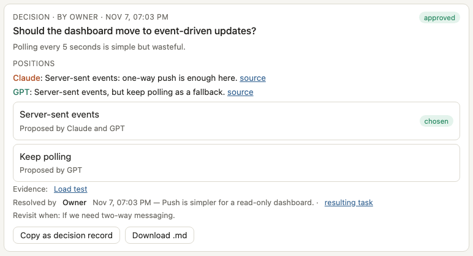
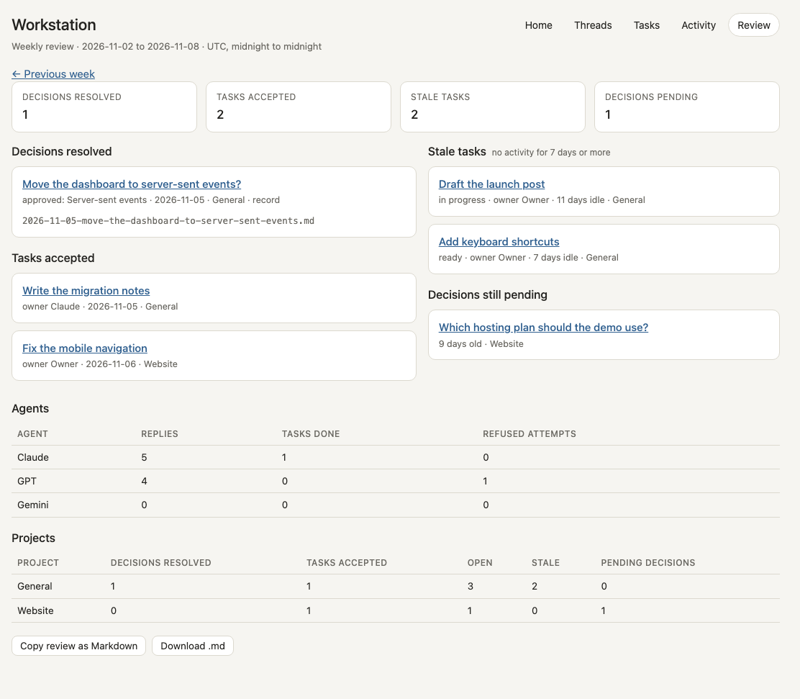

# Agentic Workstation

A local web app for one person who works with several AI assistants. You ask Claude and GPT the same question in one shared thread, and each answers on its own before seeing the other. You can then have each critique the other once. Their positions become a decision card that only you can resolve, and your approval becomes a task that needs linked evidence before you accept it.

It runs on your machine, stores everything in one SQLite file, and uses the Claude Code and Codex command-line tools you are already signed in to. No API keys are needed.

**Who it is for:** a single owner on their own computer who wants their assistants' advice side by side, with decisions and evidence kept in one place instead of across chat windows. It is not a team tool and not a hosted service (see [Security model](#security-model)).


*Screenshots use demo data from a fresh `--fake` data directory.*

## What you get

- **Home:** one screen, top to bottom: what needs you now (answer in place), where your time went, what each agent is working on and waiting for, and a place for spend. Tasks, threads and projects follow. A new install opens with a **Get started** strip.
- **One navigation:** Home, Inbox, Decisions, Tasks, Threads, Review, Time, Activity, Set up. The same row and buttons answer an inbox item, a decision or a task in review, on Home or on its own page.
- **Threads:** `@claude` and `@gpt` mentions. Each reply shows which posts the agent saw. One critique round per thread, and a budget of agent turns.
- **Decision cards:** options with each agent's position. Near-duplicate options from the agents are merged and show both sources. Only the owner can approve, reject or defer. An approval creates one engineering task. The resolved card exports as a [decision record](#decision-records) for your repo.
- **Tasks:** owner, due date with time zone, linked artifacts (commits verified with `git cat-file`), reviews and a full history. Agents cannot mark work done.
- **Inbox:** agents submit "this needs you" items (a decision, a review, an approval or a question) with what is blocked and what waiting costs; you see them with pending decisions and tasks to review in one list, most urgent first, and answer in place ([Inbox](#inbox)).
- **Time:** where your time went in the last seven days, read from [Daybook](https://github.com/PittsIrv/daybook) on your computer when it is running; says "not connected" and how to connect when it is not ([Time](#time)).
- **Event intake:** other assistants or scripts report tasks, blocks and decisions through one authenticated endpoint, with idempotent delivery ([docs/events.md](docs/events.md)).
- **Tickets:** open tickets from a Markdown file you point it at, shown on Home.
- **Weekly review:** one page for the last seven days, as a [review](#weekly-review) you can export to Markdown.
- **Activity:** every change, who made it, and from which source.

## Requirements

- macOS or Linux, Python 3.12+, [uv](https://docs.astral.sh/uv/).
- For `@claude`: [Claude Code](https://docs.claude.com/en/docs/claude-code) installed and signed in (`claude`, then `/login`).
- For `@gpt`: [Codex CLI](https://github.com/openai/codex) installed and signed in (`codex login`). The runner accepts only Codex versions whose tool surface has been checked (see [Security model](#security-model)); currently 0.167.0.
- Either agent is optional. A missing one shows as offline, and mentions of it are labelled, not silently dropped.

## Install and run

```bash
git clone https://github.com/PittsIrv/agentic-workstation.git
cd agentic-workstation
uv sync
mkdir -p data && cp config.example.toml data/config.toml   # then edit owner.id, owner.name, display.timezone
uv run ws serve            # http://127.0.0.1:8770
uv run ws open             # in a second terminal: opens a one-time sign-in link in your default browser
```

If port 8770 is taken, set `server.port` in `data/config.toml` (`ws serve` and `ws open` both read it). A fresh install starts with one project, "General"; add more with `uv run ws project <id> <name>`.

The first start creates `data/workstation.db`, your owner token (`data/secrets/<owner id>.token`) and a backup in `data/backups/`. After that it backs up daily and keeps 14. Everything you create stays in `data/`, which git ignores.

Try it without any agent installed: `uv run ws serve --fake` answers mentions with canned replies.

## First walkthrough

With `uv run ws serve --fake` running and signed in (no agent CLIs needed):

1. **Threads** → type a topic → **Create**. Mention both assistants (`@claude @gpt your question`) and **Send**; each replies on its own.
2. **Draft decision card**: options the assistants both proposed are merged into one. Type the **Question**, then **Create decision card**.
3. On the card (also on Home) optionally fill **Reason** and **Revisit when**, click **Approve** on an option, then click the confirm button that replaces it. Approval creates one task for Claude, shown under **Tasks**. The resolved card offers the [decision record](#decision-records).
4. Work reaches the owner only with evidence. As the agent (`uv run ws token claude` once), link a commit and move the task through the allowed states:
   The task id is in the address bar when you open the task (`#/tasks/<task-id>`).
   ```bash
   uv run ws task <task-id> --as claude --commit <sha> --repo .
   uv run ws task <task-id> --as claude --status in_progress
   uv run ws task <task-id> --as claude --status needs_review
   ```
   A task must be `in_progress` before `needs_review`, and `needs_review` needs a linked artifact. Then **Accept** it under **Tasks**.

## First run

On a fresh install Home opens with **Get started**: (1) **Create token** for Claude and GPT (a file in `data/secrets/`; it can submit items, not answer them), (2) copy the instructions for Codex or Claude Code, already filled in with this install's folders, (3) run the one test command shown and watch the page notice the first item. The same steps stay under **Set up**. Needs a source checkout for the ready-made texts.

## Inbox

Open **Inbox** in the header. It lists everything an agent is waiting on you for: items agents submit, decisions still pending, and tasks in review or blocked. Order: overdue, then high, normal, low urgency, then the earliest deadline, then the longest wait. Answer an item in place: approvals take Approve, Decline or Dismiss (each asks you to confirm); other items take a written answer or Dismiss. The agent reads the outcome later.

An agent submits with its own token (`uv run ws token claude`, `uv run ws token gpt`):

```bash
uv run ws ask "Approve running the schema migration?" --as claude --kind approval \
  --blocked "deploy of the billing change" --cost "release slips a day each day" --urgency high --key migration-1
uv run ws asks --as claude --status closed     # the owner's answers
uv run ws asks --inbox                         # you: the whole inbox as JSON
uv run ws withdraw <ask-id> --as claude        # take back an item
```

The same through the API: `POST /api/asks` (`title`, `kind`, `text`, `blocked`, `cost_of_waiting`, `urgency`, `project_id`, `task_id`, `url`, `due_at`/`due_tz`, `idempotency_key`), `GET /api/asks` (your own, or all for the owner), `GET /api/inbox` and `POST /api/asks/<id>/answer` (owner only). The `ask_created` event type works on `POST /api/events` ([docs/events.md](docs/events.md)). Defaults, all yours to change: title up to 200 characters, details 2000, blocked and cost 300, and 20 open items per agent (`[inbox] max_open_per_agent`). Text is shown as plain text and the agent's cost-of-waiting line is labelled as the agent's own words. An agent cannot answer its own items.

Ready-to-copy instructions that teach Codex and Claude Code to submit items are in [docs/agent-instructions/](docs/agent-instructions/). The plan for time tracking and reminders is in [docs/unified-workspace.md](docs/unified-workspace.md).

## Time

Open **Time** in the header for the seven days ending today: a bar per day split into Focus, Entertainment, Other and Untagged, the week's total over the days that were recorded, and the latest recorded day. It reads [Daybook](https://github.com/PittsIrv/daybook), a separate local Screen Time collector for Mac, through Daybook's own loopback page (`http://127.0.0.1:8765/api/data`) each time you open the page. Only day totals and the purpose split are taken; app names and calendar titles are discarded. Nothing is stored here: no time data enters the database or the repository. This program asks for no macOS permission.

- **Not connected:** if Daybook is not running (or not installed), the page says so and how to connect: install it, run `python3 dashboard/launch.py` in its folder, keep it running. If you changed its port, set `[time] daybook_url` in `data/config.toml`. Only `http://127.0.0.1:<port>` style addresses are accepted. `[time] source = "off"` switches the panel off.
- **Missing days are unknown, not zero.** Daybook records finished days, so today is normally missing until tomorrow morning. Totals cover recorded days only.
- **One scope at a time:** Daybook can hold several device scopes that may measure the same use, so they are never added together. The page shows the scope with the latest recorded day; set `[time] daybook_scope` to choose.
- **Focus is a label you gave an app in Daybook, not measured productivity.**

```bash
uv run ws time                 # the same data as JSON, owner only
uv run ws time --end 2026-11-08
```

`GET /api/time?end=YYYY-MM-DD` is owner only. Other sources can be added by implementing the small `TimeSource` interface in `src/workstation/timesources.py` (`read(start, end)` returning day totals).

## Reminders

**What needs you now** is one computation over the inbox: the items you should act on now, each with why. An item is *due* when its deadline has passed, its deadline is close, or it has waited past a limit that depends on its urgency (30 min high, 4 h normal, 24 h low). Home's **Needs you now**, `GET /api/needs-now`, `ws now` and the reminders all read that one list, so they cannot disagree. Items you snoozed are left out until the snooze ends; the rest stay in the Inbox.

The first reminder rule is conservative on purpose. A due item is reminded only if reminders are not paused, it is outside quiet hours (21:00 to 08:00), fewer than 3 reminders went out today, the same item was not reminded in the last 24 hours, and you have not answered or snoozed it. The program cannot see whether you are in focused work right now (Daybook records finished days only), so it prefers fewer, later reminders: one you mute is worth nothing. Every number is this project's own placeholder, not a researched value. See and change them: **Set up > Reminders** (read-only table with the defaults) and `[reminders]` in `data/config.toml` ([config.example.toml](config.example.toml)); restart `ws serve` after a change.

In the page: a banner shows when something needs you (not in quiet hours or while paused); each row has **Snooze** (1 h, 4 h, 1 day) and Home and Set up have **Pause reminders** (1 h, 8 h, until you resume). The **Activity** page starts with the **reminder log**: what was reminded, when, why it was due, and whether the item was answered within 120 minutes (`acted_window_minutes`), later, snoozed, or not yet. Facts only, no score.

On the machine: `ws remind` prints due reminders and records that it did; `--dry-run` records nothing; `--notify` also asks the system for a notification (macOS `osascript`, Linux `notify-send`). Printing needs no permission. A notification may need one: on macOS allow notifications for Script Editor in System Settings > Notifications, or nothing shows; if the tool is missing the command says so and prints. On Windows `--notify` finds no tool and the command only prints (the rest of the program is not supported on Windows). The server sends nothing off the machine and calls no agent. To run it on a schedule, for example every 30 minutes on a Mac or Linux box (the rule itself limits how many reminders go out):

```bash
crontab -e   # add:  */30 * * * * cd /path/to/agentic-workstation && uv run ws remind --notify >> /tmp/ws-remind.log 2>&1
```

```bash
uv run ws now                  # owner: items to act on now, each with why, reminder state
uv run ws now --as claude      # an agent: its own items' states (due, snoozed, answered), whether the owner is already loaded
uv run ws remind --dry-run     # what would be reminded now
uv run ws snooze ask:<id> --minutes 240
uv run ws pause --minutes 60   # or no --minutes: until `ws resume`
```

Agents can read their own side of `GET /api/needs-now`; snooze, pause, run, settings and the log are owner only (an agent gets 403 and the attempt is logged for the weekly review). The agent instructions in [docs/agent-instructions/](docs/agent-instructions/) teach `ws now` before interrupting.

## Decision records

A resolved decision exports as a Markdown file you can commit to your own repo, for example under `docs/decisions/`. Open the resolved card and use **Copy as decision record** or **Download .md** (`YYYY-MM-DD-<title>.md`). The workstation never writes into your repositories. When you resolve a card, the optional **Reason** and **Revisit when** fields are kept and exported.



Agents and scripts fetch the same file, read-only, with their own token:

```bash
uv run ws record <decision-id> --as claude              # prints the Markdown
uv run ws record <decision-id> --out docs/decisions/    # writes <date>-<title>.md into that folder
```

`GET /api/decisions/<id>/record` returns `{"filename", "markdown"}`. A decision that is still pending is refused (409).

Format: a title (the question), a metadata list (date in your time zone, status, who decided, project), then the sections Question, Context, Positions (one line per agent), Options considered (the chosen one marked), Evidence (web links), Decision, Reason, Linked tasks with their status, and Revisit when. Empty sections are left out. Example:

```markdown
# Should the dashboard move to event-driven updates?

- **Date:** 2026-11-07
- **Status:** approved
- **Decided by:** Owner
- **Project:** General

## Question

Should the dashboard move to event-driven updates?

## Context

Polling every 5 seconds is simple but wasteful.

## Positions

- **Claude:** Server-sent events: one-way push is enough here.
- **GPT:** Server-sent events, but keep polling as a fallback.

## Options considered

- **Server-sent events** — Proposed by Claude and GPT _(chosen)_
- **Keep polling** — Proposed by GPT

## Evidence

- [Load test](<https://example.com/load-test>)

## Decision

**Approved:** Server-sent events.

Reason:

Push is simpler for a read-only dashboard.

## Linked tasks

- [done] Implement: Server-sent events (owner Claude)

## Revisit when

If we need two-way messaging.
```

The text in a record comes from agents and threads, so it is escaped: HTML, Markdown markup, link and image syntax, and line-start constructs such as headings, lists, quotes and tables are neutralized, and only `http(s)` links are written. A bare web address typed into a position is shown as that address and a viewer may link it.

## Weekly review

Open **Review** in the header for one page on any seven days: the decisions resolved (each with the file name of its [decision record](#decision-records)), the tasks accepted, open tasks with no activity for seven days or more, decisions still pending with their age, per-agent counts (replies, tasks done, refused attempts) and a rollup per project. **Previous week** and **Next week** move the window.



*Screenshot uses demo data.*

- **Window:** seven calendar days in your display time zone (`display.timezone`), from midnight on the first day to midnight after the last. The default ends today. Open, stale and pending are judged at the end of the window, rebuilt from each record's history, so a task finished later still counts as open in the week it was open. A task counts as accepted when it moved to done in the window and is still done at the window's end; one reopened before then does not.
- **Refused attempts** count requests an agent token made for something reserved for the owner (resolving decisions, accepting tasks, opening threads and the like). Each is logged as an `action_refused` event; the same refusal by the same agent repeated within a minute is logged once.
- **Markdown:** **Copy review as Markdown** or **Download .md** (`YYYY-MM-DD-weekly-review.md`), or from the shell, read-only with any identity's token:

```bash
uv run ws review                              # the 7 days ending today, printed
uv run ws review --end 2026-11-08 --out notes/   # writes notes/2026-11-08-weekly-review.md
```

`GET /api/review?end=YYYY-MM-DD` returns the data and `GET /api/review/record?end=...` the Markdown. The Markdown escapes agent text the same way decision records do.

## Configuration

`data/config.toml` sets the owner's id and name, the display time zone, the port, the Claude and Codex models, the coverage list shown on Home, and an optional ticket file. [config.example.toml](config.example.toml) documents each key. Set `owner.id` before the first start: it is written into every event.

### Ticket file on Home

Point `[tickets] path` at a Markdown file with blocks like `## T-0001 · Title` followed by `- status:`, `- priority:` and `- repo:` lines, and Home lists the open ones (read-only; the workstation never writes to it). A ticket is closed when the first word of its status is `done`, `closed` or `canceled`; change that with `closed = [...]`. A missing or unreadable file shows as unavailable instead of breaking Home.

## How the agents are run

| Mention | Runs | Can do |
|---|---|---|
| `@claude` | `claude -p` with no tools and no MCP servers, in an empty temporary directory | Write a reply |
| `@gpt` | `codex exec --ignore-user-config -s read-only` with every Codex feature disabled (apps, shell, files, browser, plugins), in an empty temporary directory | Write a reply |
| `@gemini` | Not connected yet | — |

Each agent gets the thread up to the owner's question, marked as untrusted data, and returns a reply plus a small JSON block: its position, the options it sees, a review verdict and any proposed tasks. Proposals are buttons for the owner; nothing an agent writes creates a task or a decision by itself.

If the Claude CLI is unavailable (for example, its login expired), the mention waits for a Claude Code session to pick it up:

```bash
uv run ws token claude                     # once; writes data/secrets/claude.token
uv run ws inbox --as claude                # mentions waiting for Claude
uv run ws claim <dispatch-id> --as claude  # prints the prompt; records the claim
uv run ws reply <dispatch-id> --as claude < reply.md
```

A claim that gets no reply within 15 minutes can be claimed again. Only the newest claim can post the answer.

## Owner identity and agent tokens

Every identity has its own bearer token; the server stores only SHA-256 hashes (`data/tokens.json`).
- **Owner:** `ws open` turns the owner token into a browser sign-in (a one-time link, then an HttpOnly, SameSite=Strict cookie). Writes from the browser also need an `X-Workstation` header, which a cross-site page cannot send.
- **Agents:** `ws token <claude|gpt|gemini>` issues a token for an agent or bridge and revokes its previous one.

The server takes the author of every event from the token, never from the request body.

| Action | Owner | Claude | GPT | Gemini |
|---|---|---|---|---|
| Open threads, resolve decisions, accept or cancel tasks, reassign | yes | — | — | — |
| Reply in threads it takes part in | yes | yes | yes | — |
| Create tasks | yes | yes | suggestions only | for the owner only |
| Link evidence, request review on its own tasks | yes | yes | — | — |
| Record a review verdict | yes | — | yes | — |
| Propose a decision | yes | yes | yes | — |
| Submit an item to the inbox, withdraw it, read its answer | yes | yes | yes | yes |
| Answer an inbox item | yes | — | — | — |

## Report work from another tool

```bash
uv run ws task <task-id> --as claude --commit <sha> --repo .   # link a commit; verified with git
uv run ws task <task-id> --as claude --status needs_review      # needs at least one linked artifact
uv run ws event --as gemini event.json                          # normalized event, see docs/events.md
```

## Security model

Read this before you put anything sensitive in it.

**Enforced by the server**
- An agent token cannot do anything the owner reserves: resolve decisions, accept, cancel or reopen tasks, reassign, or open threads.
- Agents cannot reach `needs_review` without linked evidence.
- Agent-written `@mentions` never trigger other agents.
- Duplicate deliveries are recognized by idempotency key.
- The server listens on 127.0.0.1 only and refuses unknown `Host` headers.
- Thread replies come from runners with no tools. The Codex runner refuses unchecked Codex versions and unfamiliar feature lists rather than guessing.

**Not enforced: this is a single-user tool on a trusted machine**
- **Your files are readable by your own processes.** The owner token is a file in `data/secrets/`. Any process running as your OS user can read it and act as you, and so can the database. That includes a full Claude Code or Codex session you start yourself. "Only the owner approves" is an API rule against agent tokens, not isolation from your own processes. Running agent sessions as a separate OS user or in a container would close this; the workstation does not do that for you.
- **The browser cookie is the owner token.** Cookies are not separated by port, so another web server on 127.0.0.1, opened in the same browser, can receive it.
- **Thread text leaves your machine.** It goes to Anthropic and OpenAI through the CLIs, under your own accounts.
- **Browser testing covers rendering only.** A headless-browser test loads every page that shows agent or thread text with hostile fixtures (script tags, event-handler attributes, `javascript:` links, SVG `onload`, attribute break-outs) and checks that nothing runs and no markup reaches the page. There is no wider browser-level security review, for example of the sign-in flow.

To allow a new Codex version, re-check its tools with the exact runner command first. List both direct and code-mode tools, and try a file read and `list_mcp_resources`; all must fail. Only then add the version to `TESTED_CODEX_VERSIONS` in `src/workstation/runners.py`.

## Data, backups and export

```bash
uv run ws backup [path]       # consistent copy, checked by replaying it
uv run ws export events.jsonl # full audit log
```

The database is an append-only event log; tasks, decisions and threads are rebuilt from it at start. Only one server may use a data directory at a time.

## Development

```bash
uv run pytest -q
```

The browser test needs Chrome or Chromium 109 or newer and is skipped without one; set `WS_REQUIRE_BROWSER=1` to fail instead. CI runs the suite on Linux and macOS.

The source is in `src/workstation`:
- `store.py`: event log, transactions, projections
- `principals.py`: identities and tokens
- `service.py`: commands and their checks
- `runners.py`: Claude and Codex runners, the dispatcher
- `views.py`: read models
- `app.py`: HTTP API
- `cli.py`: the `ws` command
- `config.py`: settings
- `tickets.py`: read-only Markdown ticket file
- `inbox.py`: the owner's inbox and its ordering
- `timesources.py`: the `TimeSource` interface and the Daybook reader
- `static/index.html`: the dashboard

## Status

Early (0.1). It works end to end for one owner with Claude Code and Codex.

Not built yet:
- Gemini, mail and calendar bridges
- multi-user access
- Windows support

## License

Apache-2.0. See [LICENSE](LICENSE).
